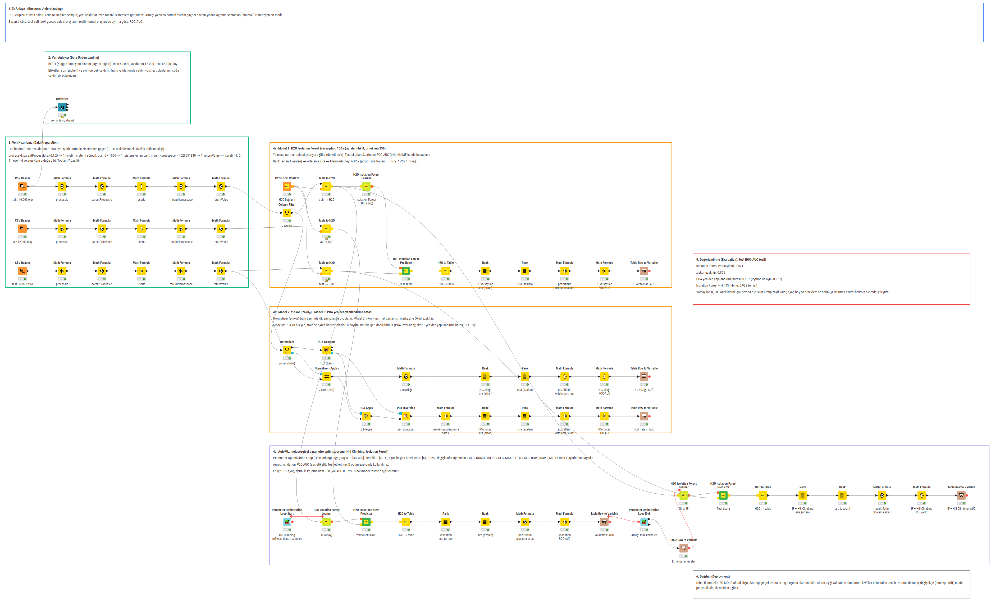

# BETH ile Anomali Tespiti (Kernel Sistem Çağrıları)

Bir honeypot sunucusunda kaydedilen kernel süreç olaylarında (BETH) **hiç saldırı görmeden** eğitilen anomali modelleri, test setindeki gerçek saldırgan aktivitesini ayırt etmeye çalışıyor. Problem önce **KNIME** ile, sonra **Python** ile, her ikisinde de **CRISP-DM** adımlarıyla çözüldü.



## Sonuçlar (test ROC-AUC, gerçek saldırılar)

### KNIME

| Model | ROC-AUC |
|---|---|
| **H2O Isolation Forest + Hill Climbing** | **0.923** |
| PCA yeniden yapılandırma hatası | 0.907 |
| z-skor uzaklığı | 0.865 |
| H2O Isolation Forest (varsayılan) | 0.621 |

### Python (scikit-learn)

| Model | ROC-AUC | PR-AUC |
|---|---|---|
| **AutoML: One-Class SVM (NSGA-II)** | **0.9915** | **0.9977** |
| Autoencoder | 0.9910 | 0.9970 |
| One-Class SVM (varsayılan) | 0.9909 | 0.9972 |
| Isolation Forest | 0.9152 | 0.9828 |
| PCA | 0.9074 | 0.9777 |
| LOF | 0.8243 | 0.9516 |

Operasyonel eşikte (validation skorlarının %99'luk dilimi) saldırı olaylarının %99.3'ü yakalandı.

## AutoML

| | KNIME | Python |
|---|---|---|
| Metasezgisel parametre optimizasyonu | Parameter Optimization Loop, **Hill Climbing** (ağaç sayısı, derinlik, örneklem) | Optuna **NSGA-II** çok amaçlı genetik algoritma, 40 deneme |
| Amaç | Validation ROC-AUC (`sus`) | PR-AUC (`sus`) + kararlılık |
| Algoritma seçimi | Isolation Forest, z-uzaklığı ve PCA karşılaştırması | IF, LOF, One-Class SVM ve Autoencoder arasından GA seçimi |

Test etiketi (`evil`) iki platformda da optimizasyonda kullanılmadı.

## Klasör yapısı

```
knime/       KNIME_Anomali_BETH.knwf, iş akışı görseli (png/svg)
notebooks/   01_beth_anomaly_detection.ipynb (çalıştırılmış, çıktılarıyla)
docs/        KNIME_Raporu.md, Python_Raporu.md, figures/
data/        40.000 / 12.000 / 12.000 olaylık örneklem ve kaynak bilgisi
models/      beth_anomaly_config.joblib (scaler + One-Class SVM + eşik)
results/     knime_results_raw.json
```

## Çalıştırma

**KNIME:** KNIME Analytics Platform 5.x ve H2O Machine Learning Integration gerekir. File → Import KNIME Workflow → `knime/KNIME_Anomali_BETH.knwf`. Veri iş akışının içinde.

**Python:**
```bash
pip install -r requirements.txt
jupyter notebook notebooks/01_beth_anomaly_detection.ipynb
```

## Raporlar

- [KNIME raporu](docs/KNIME_Raporu.md)
- [Python raporu](docs/Python_Raporu.md)

Veri: [BETH Dataset](https://www.kaggle.com/datasets/katehighnam/beth-dataset) (Highnam vd., 2021).
