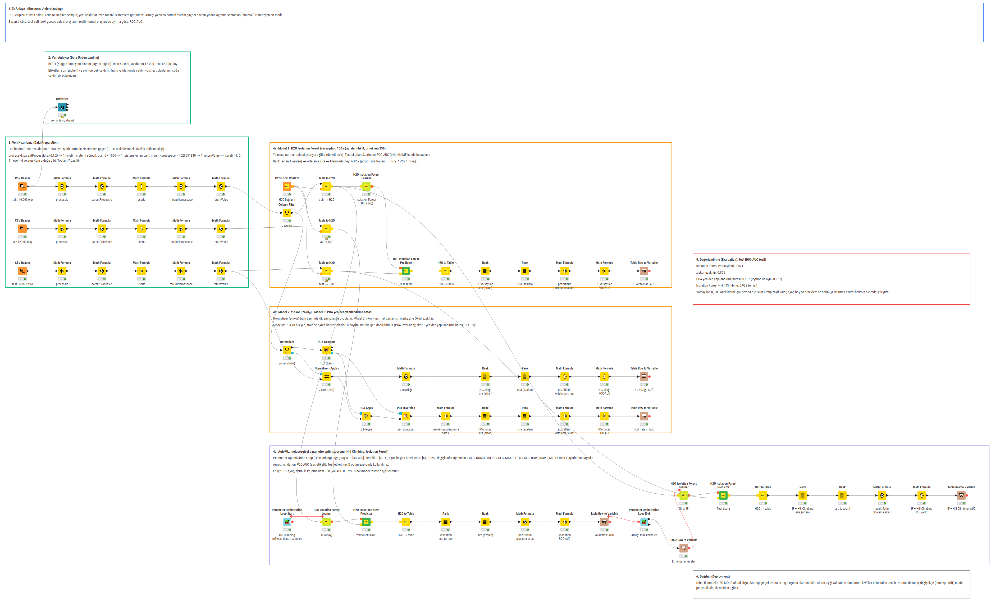

# KNIME Raporu: BETH ile Anomali Tespiti

İş akışı: `knime/KNIME_Anomali_BETH.knwf` (KNIME Analytics Platform 5.x, H2O Machine Learning Integration)



İş akışı CRISP-DM aşamalarına göre renkli kutulara ayrılmıştır. Her kutunun içinde o aşamanın açıklaması yazılıdır.

## 1. İş Anlayışı

SOC ekipleri nadiren etiketli saldırı verisine sahiptir ve imza tabanlı sistemler yeni saldırıları göremez. Amaç, yalnızca normal sistem çağrısı davranışından öğrenip bu davranıştan sapan olayları işaretlemek.

Başarı ölçütü: test setindeki gerçek saldırı olaylarını (`evil`) ayırma gücü. Ölçüt eşikten bağımsız olan ROC-AUC'dir.

## 2. Veri Anlayışı

| Düğüm | Görev |
|---|---|
| CSV Reader ×3 | train 40.000, validation 12.000, test 12.000 olay |
| Statistics | Dağılımlar. Train ve validation'da saldırı yok. Test olaylarının %83.7'si saldırı. |

## 3. Veri Hazırlama

Her bölüm aynı Math Formula zincirinden geçer. Kullanılan özellikler BETH makalesindeki alan bilgisine dayanır:

| Özellik | Math Formula |
|---|---|
| processId, parentProcessId | `if($x$ <= 2, 1, 0)`: işletim sistemi süreci |
| userId | `if($userId$ < 1000, 1, 0)`: sistem kullanıcısı |
| mountNamespace | `if($mountNamespace$ == 4026531840, 1, 0)` |
| returnValue | işaret (-1, 0, 1) |
| eventId, argsNum | olduğu gibi |

## 4. Modelleme

Üç model de yalnızca normal train olaylarıyla, denetimsiz olarak eğitilir:

1. **H2O Isolation Forest**: varsayılan ayarlar (100 ağaç, derinlik 8, ağaç başına 256 örnek).
2. **z-skor uzaklığı**: Normalizer z-skoru train üzerinde öğrenir ve test'e uygular (Normalizer Apply). Skor, olayın normal davranışın merkezine olan Öklid uzaklığıdır.
3. **PCA yeniden yapılandırma hatası**: PCA Compute (3 bileşen) train üzerinde çalışır. Test olayları PCA Apply ile 3 boyuta indirilir, PCA Inversion ile geri dönüştürülür. Skor Σ(x − x̂)²'dir.

**ROC-AUC KNIME içinde hesaplanır** (Mann–Whitney U):

```
Rank (artan) → Rank (azalan) → Math Formula: eşit skorlar için ortalama sıra
→ Math Formula: AUC = (Σ pozitif sıra − n₁(n₁+1)/2) / (n₁ · n₀) → Table Row to Variable
```

## 4c. AutoML: metasezgisel parametre optimizasyonu (Hill Climbing)

```
Parameter Optimization Loop Start (Hillclimbing: nTrees 50-300, depth 4-14, sample 64-1024)
  → H2O Isolation Forest Learner (CFG_NUMOFTREES, CFG_MAXDEPTH, CFG_ROWSAMPLESIZEPERTREE akış değişkenlerine bağlı)
  → Predictor (validation) → AUC zinciri (sus etiketi)
→ Parameter Optimization Loop End (AUC'yi maksimize et)
→ Table Row to Variable → Nihai Isolation Forest → test → AUC zinciri (evil)
```

Optimizasyonda yalnızca validation'daki `sus` etiketi kullanılır. Test etiketi `evil` bu aşamaya hiç girmez.

| Ağaç | Derinlik | Örneklem | Val AUC |
|---|---|---|---|
| 181 | 10 | 232 | 0.363 |
| 231 | 10 | 360 | 0.807 |
| 181 | 10 | 360 | 0.844 |
| 181 | 12 | 488 | 0.638 |
| **181** | **12** | **360** | **0.872** |
| 181 | 14 | 360 | 0.790 |

Bu tablo 16 denemenin bir seçkisidir. Tamamı `results/knime_results_raw.json` dosyasında.

## 5. Değerlendirme (test, ROC-AUC, `evil`)

| Model | KNIME | Python |
|---|---|---|
| **Isolation Forest + Hill Climbing** | **0.923** | – |
| PCA yeniden yapılandırma hatası | 0.907 | 0.907 |
| z-skor uzaklığı | 0.865 | – |
| Isolation Forest (varsayılan) | 0.621 | 0.915 (scikit-learn) |
| One-Class SVM + NSGA-II (Python AutoML) | – | 0.992 |

- PCA iki platformda aynı sonucu verdi (0.907). Bu, veri hazırlamanın iki tarafta tutarlı olduğunu gösteriyor.
- H2O Isolation Forest varsayılan ayarlarla zayıf kaldı. Özelliklerin çoğu ikili (0/1) olduğundan küçük örneklem ve sığ ağaçlar çok sayıda eşit skor üretiyor.
- Hill Climbing derinliği ve ağaç başına örneklemi artırarak test AUC'sini 0.621'den **0.923**'e çıkardı. Arama yüzeyi engebeli: örneklem 232'de AUC 0.36'ya düşüyor. Bu yüzden yerel arama başlangıç noktasına duyarlı.
- Python tarafında One-Class SVM ve çok amaçlı GA daha yüksek sonuç verdi (0.992). KNIME'da One-Class SVM düğümü yok; en iyi KNIME modeli Python'daki tekil IF ve PCA sonuçlarını geçti.

## 6. Dağıtım

Nihai Isolation Forest H2O MOJO olarak dışa aktarılabilir ve log akışında gerçek zamanlı skorlanabilir. Alarm eşiği validation skorlarının %99'luk diliminden seçilir. Normal davranış değiştikçe (concept drift) model periyodik olarak yeniden eğitilmelidir.
