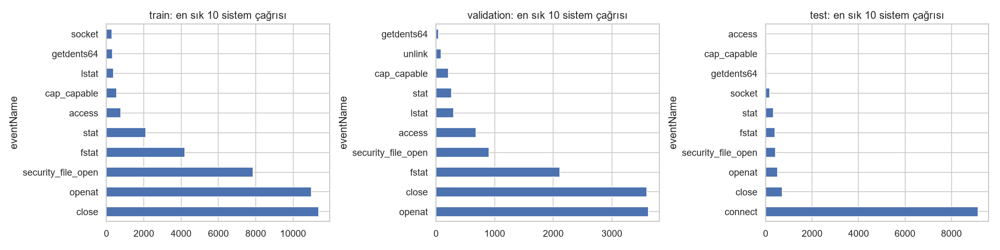
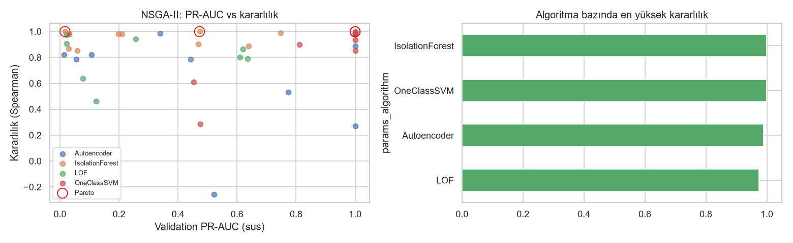
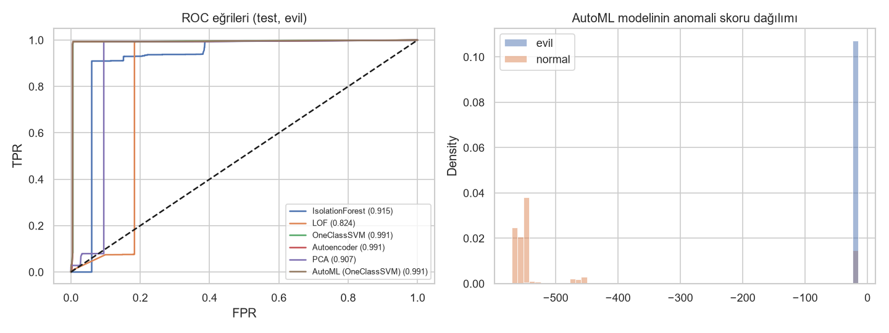

# Python Raporu: BETH ile Anomali Tespiti (Kernel Süreç Olayları)

Notebook: [`notebooks/01_beth_anomaly_detection.ipynb`](../notebooks/01_beth_anomaly_detection.ipynb) (çalıştırılmış, tüm çıktılarıyla)

Kütüphaneler: pandas, scikit-learn, SciPy, Optuna, matplotlib, seaborn.

## 1. İş Anlayışı

İmza tabanlı sistemler bilinmeyen (zero-day) saldırıları kaçırır. Normal sistem davranışını öğrenip bundan sapmaları işaretleyen bir model yeni saldırıları da yakalayabilir.

- **Kritik koşul:** eğitim ve validation verisinde saldırı (`evil`) yok. Model saldırı görmeden eğitilir; test verisi ise saldırı içerir. Gerçek bir *Out-of-Distribution* senaryosu.
- Ölçütler: eşikten bağımsız **ROC-AUC** ve **PR-AUC**; operasyonel eşikte precision / recall / F1.

## 2. Veri Anlayışı

- BETH (Highnam vd., 2021): bir honeypot sunucusunda kaydedilmiş 8 milyondan fazla kernel seviyesi süreç olayı (sistem çağrısı). Resmi ayrımlardan sabit tohumlu örnek: **40.000 / 12.000 / 12.000**.
- `evil` oranı: eğitim 0, validation 0, test **%83.7**. `sus` (şüpheli) oranı: eğitim %0.2, validation %0.3 (40 olay).
- Testteki saldırı olaylarının çoğu `tsm` sürecinden (9.431 olay), ardından sshd, w, passwd, grep, sh.
- Sistem çağrısı dağılımı eğitim ile test arasında belirgin şekilde kayıyor; bu kayma OoD tespitinin temeli.

## 3. Veri Hazırlama

BETH makalesinde önerilen alan bilgisine dayalı özellikler:

| Özellik | Dönüşüm | Anlamı |
|---|---|---|
| processId, parentProcessId | {0,1,2} ise 1 | İşletim sistemi süreci mi (init/kthreadd) |
| userId | < 1000 ise 1 | Sistem kullanıcısı mı |
| mountNamespace | 4026531840 ise 1 | Ana (host) namespace'te mi |
| eventId | olduğu gibi | Sistem çağrısı türü |
| argsNum | olduğu gibi | Argüman sayısı |
| returnValue | işaret: -1 / 0 / 1 | Hata / başarı / pozitif dönüş |

`args`, `stackAddresses`, `hostName` gibi yüksek kardinaliteli, ortama özgü alanlar kullanılmadı. StandardScaler yalnızca eğitim verisinden öğrenildi.

## 4. Modelleme

### 4.1 Beş anomali algoritması (validation, `sus` etiketiyle)

| Model | Val ROC-AUC | Val PR-AUC |
|---|---|---|
| One-Class SVM | 1.000 | 1.000 |
| PCA (yeniden yapılandırma hatası) | 1.000 | 1.000 |
| Local Outlier Factor | 0.992 | 0.691 |
| Autoencoder (MLP) | 0.969 | 0.198 |
| Isolation Forest | 0.910 | 0.022 |

### 4.2 AutoML: çok amaçlı genetik algoritma (NSGA-II)

Validation'da yalnızca 40 şüpheli olay var ve iyi modellerin çoğunda ROC-AUC ve PR-AUC 1.0'a doyuyor. Tek bir etiket metriği konfigürasyonları ayırt edemiyor ve küçük bir etikete aşırı uyuma açık. Bu yüzden GA iki amacı birlikte maksimize ediyor:

1. **PR-AUC (sus)**: şüpheli olayları üst sıralara koyabilme (etiketli amaç).
2. **Kararlılık**: aynı konfigürasyon eğitim verisinin iki ayrık 10 bin satırlık alt örneğiyle ayrı ayrı eğitildiğinde validation olaylarına verdiği skorların Spearman sıra korelasyonu (etiketsiz amaç). Veri değişince sıralaması bozulan model yeni saldırılarda da güvenilmez olur.

- Arama uzayı: Isolation Forest, LOF, One-Class SVM, Autoencoder ve her birinin hiperparametreleri. Optuna `NSGAIISampler`, popülasyon 10, 40 deneme.
- Seçim kuralı: PR-AUC'si en iyinin %1'i içinde kalan Pareto konfigürasyonları arasından **en kararlı** olan.
- Sonuç: Pareto cephesinde 4 konfigürasyon; seçilen **One-Class SVM** (nu = 0.075, gamma = 0.011), PR-AUC 1.000, kararlılık 0.999.
- Test setindeki `evil` etiketi optimizasyonda hiç kullanılmadı.

## 5. Değerlendirme (test, gerçek saldırılar)

| Model | Test ROC-AUC | Test PR-AUC |
|---|---|---|
| **AutoML (One-Class SVM)** | **0.9915** | **0.9977** |
| Autoencoder | 0.9910 | 0.9970 |
| One-Class SVM (varsayılan) | 0.9909 | 0.9972 |
| Isolation Forest | 0.9152 | 0.9828 |
| PCA | 0.9074 | 0.9777 |
| LOF | 0.8243 | 0.9516 |

Validation'da 1.0 alan PCA testte 0.907'ye düştü: tek metrikle seçim yanıltıcı olurdu. Kararlılık amacıyla seçilen AutoML modeli testte en iyisi oldu.

**Operasyonel eşik:** etiketsiz senaryoda eşik test etiketine bakılarak seçilemez. Eşik, validation skorlarının %99'luk dilimi (normal olayların yaklaşık %1'i alarm üretir).

| Sınıf | Precision | Recall | F1 |
|---|---|---|---|
| normal | 0.960 | 0.853 | 0.903 |
| evil | 0.972 | **0.993** | 0.982 |

Saldırı olaylarının %99.3'ü yakalandı; alarmların %97.2'si gerçek saldırı.

## 6. Dağıtım ve sonuç

- Model (scaler + One-Class SVM + eşik) `models/beth_anomaly_config.joblib` dosyasında. Bir EDR/SIEM hattında her sistem çağrısını skorlayabilir; eşik üstü olaylar süreç ağacıyla birlikte analiste gider.
- Hiç saldırı görmeden eğitilen modeller gerçek saldırgan aktivitesini yüksek doğrulukla ayırdı. Bu, BETH makalesindeki "basit, alan bilgisine dayalı özellikler + yoğunluk/izolasyon tabanlı yöntemler" bulgusuyla uyumlu.
- Kısıtlar: örneklem küçük; test setindeki saldırı oranı gerçek hayattan çok yüksek, bu yüzden üretimde precision daha düşük olacaktır. Veri setinin DNS bölümü kapsam dışı.
